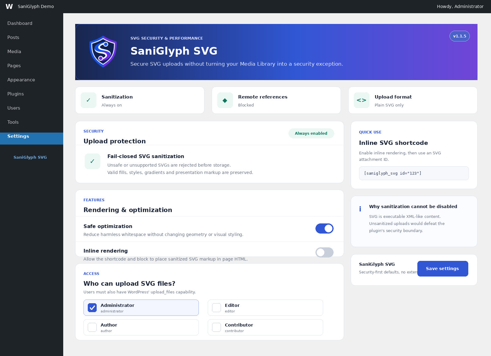
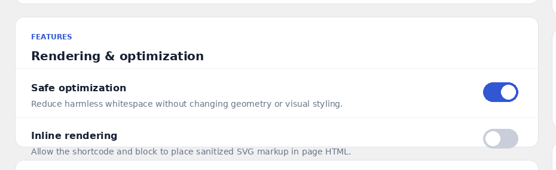
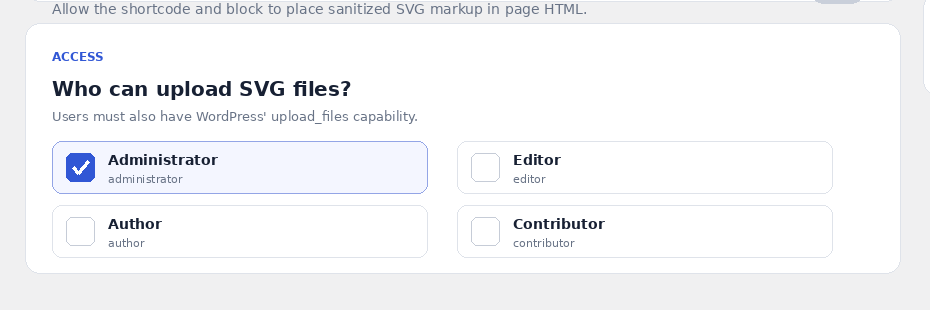
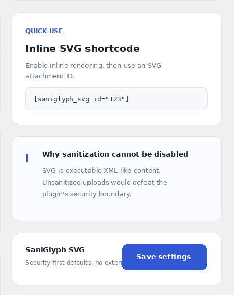

# SaniGlyph SVG User Guide

SaniGlyph SVG enables secure SVG uploads in WordPress while keeping sanitization permanently active. Version 1.1.5 supports Media Library previews, conservative optimization, role-based upload access, an optional inline shortcode, and an Inline SVG block.

## Requirements

- WordPress 6.4 or newer
- PHP 7.4 or newer
- PHP DOM extension enabled
- An administrator account for initial configuration

If PHP DOM is unavailable, the plugin deliberately keeps SVG uploads disabled. This fail-closed behavior prevents weaker or incomplete sanitization.

## Install and activate

1. In WordPress, open **Plugins > Add New Plugin > Upload Plugin**.
2. Select `saniglyph-svg-1.1.5.zip`.
3. Choose **Install Now**, then **Activate Plugin**.
4. Open **Settings > SaniGlyph SVG**.

## Dashboard overview

The top of the settings page shows the installed version and three security checks: sanitizer availability, blocked remote references, and the allowed upload format.



Sanitization is always enabled and cannot be switched off. Unsafe or unsupported SVG files are rejected before WordPress stores them. Accepted artwork keeps its safe fills, strokes, gradients, CSS, and presentation details.

## Configure rendering and optimization



### Safe optimization

Enabled by default. It reduces harmless inter-element whitespace without rounding coordinates, changing geometry, altering text spacing, or removing `<title>` and `<desc>` accessibility content.

### Inline rendering

Disabled by default. Enable it only when a page needs the SVG markup inside the HTML—for example, to style paths with CSS or access SVG elements through JavaScript. Normal Media Library use does not require this option.

After changing a setting, select **Save settings**.

## Choose who may upload SVG files



1. Under **Who can upload SVG files?**, select the permitted WordPress roles.
2. Leave access limited to trusted roles. **Administrator** is the secure default.
3. Select **Save settings**.

The selected role is only one part of the permission check. A user must also have WordPress's `upload_files` capability.

## Upload an SVG

1. Open **Media > Add New Media File**.
2. Upload a plain `.svg` file.
3. Open the attachment to confirm its preview and dimensions.

The plugin intentionally does not support `.svgz`. If a file contains scripts, event handlers, external references, unsafe URL schemes, DTDs, or unsupported active content, the upload is rejected rather than partly rewritten.

## Display SVG files

### Use the Media Library URL

Use the uploaded file like a normal image attachment in a supported editor or page builder. This is the simplest option when inline styling is unnecessary.

### Use the shortcode

Enable **Inline rendering**, then insert:

```text
[saniglyph_svg id="123"]
```

Replace `123` with the SVG attachment ID. Optional attributes are `class`, `width`, and `height`:

```text
[saniglyph_svg id="123" class="site-logo" width="160" height="48"]
```



### Use the block editor

1. Add the **Inline SVG** block.
2. Choose an SVG from the Media Library.
3. Optionally set its width and height in the block controls.

Inline output is validated again at render time.

## Troubleshooting

### SVG uploads remain disabled

Confirm that the PHP DOM extension is installed and enabled for the PHP version used by WordPress. The settings page and Plugins screen show an administrator notice when DOM is unavailable.

### WordPress says the file type is not permitted

Confirm that:

- SaniGlyph SVG is active.
- Your role is selected in **Settings > SaniGlyph SVG**.
- Your account has the `upload_files` capability.
- The file extension is `.svg`, not `.svgz`.

### The SVG is rejected

The file contains unsafe or unsupported content. Remove scripts, event attributes, external URLs, imports, DTDs, entities, and executable URL schemes in the source application, then export a plain SVG again. Do not bypass sanitization.

### Colors or styling look different

Version 1.1.5 retains the visual-fidelity fixes introduced in 1.1.3. Clear page and CDN caches, confirm the new plugin version is active, and re-upload the original SVG. If the file relies on an external stylesheet or remote resource, it will be rejected by design.

## Privacy and external services

SaniGlyph SVG does not collect telemetry, contact external services, or load remote JavaScript or CSS.
